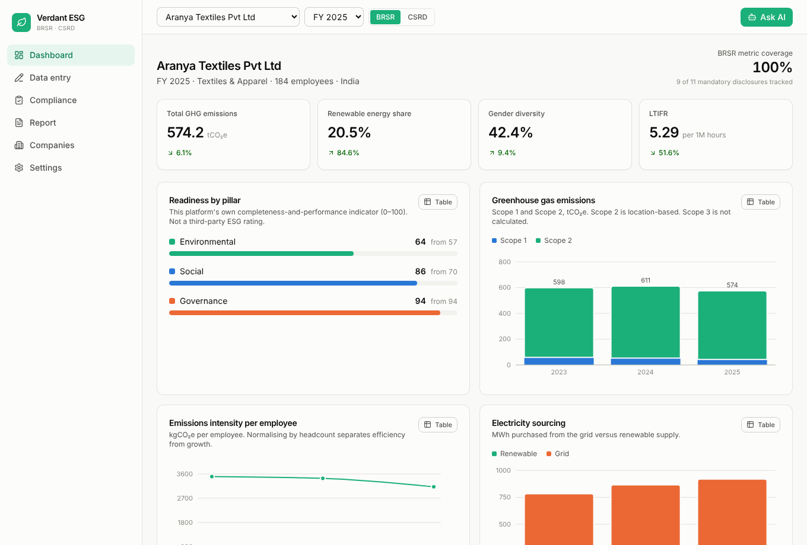
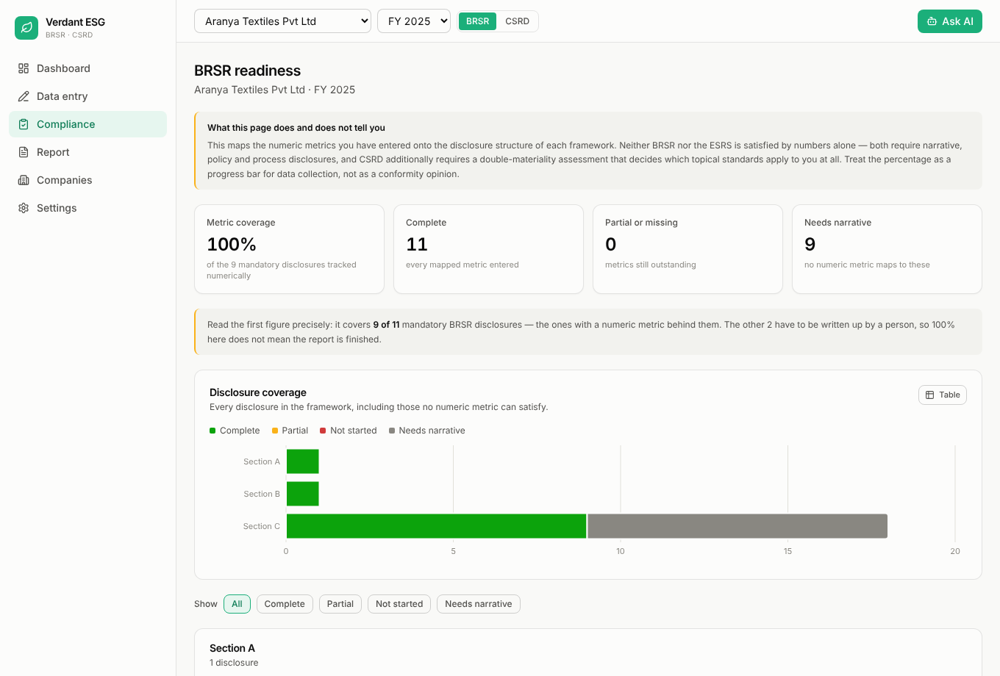
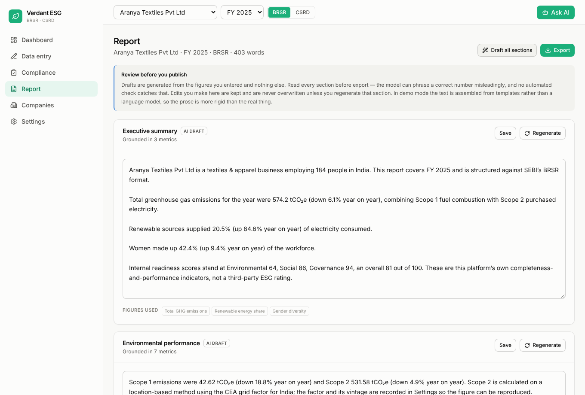
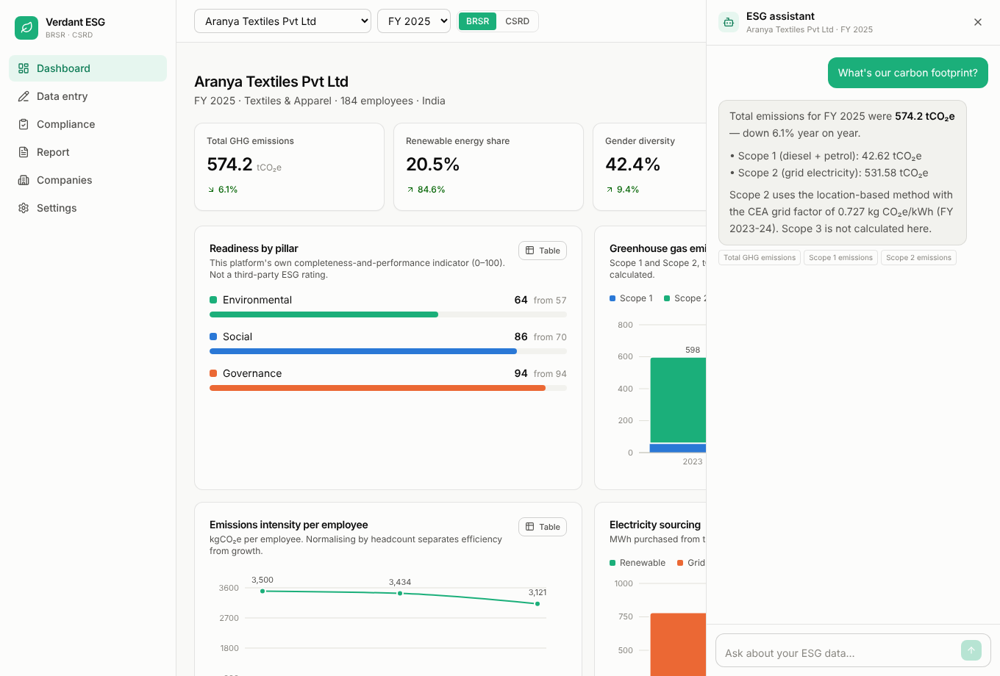
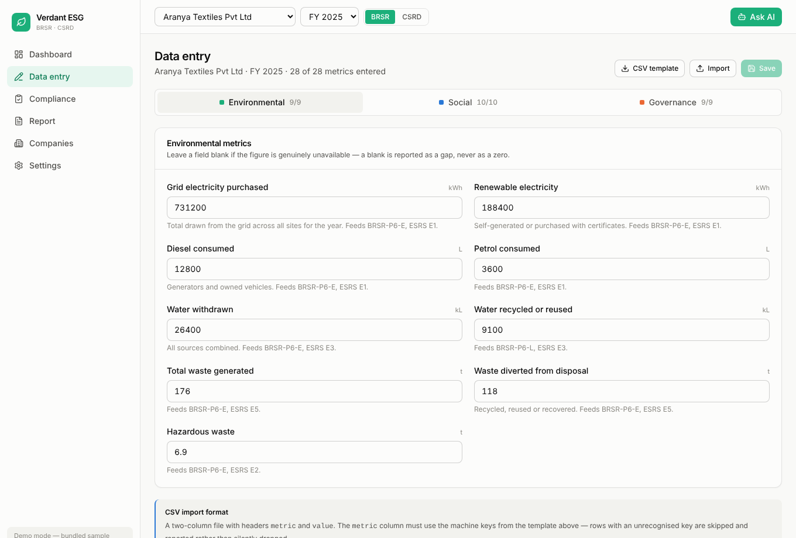
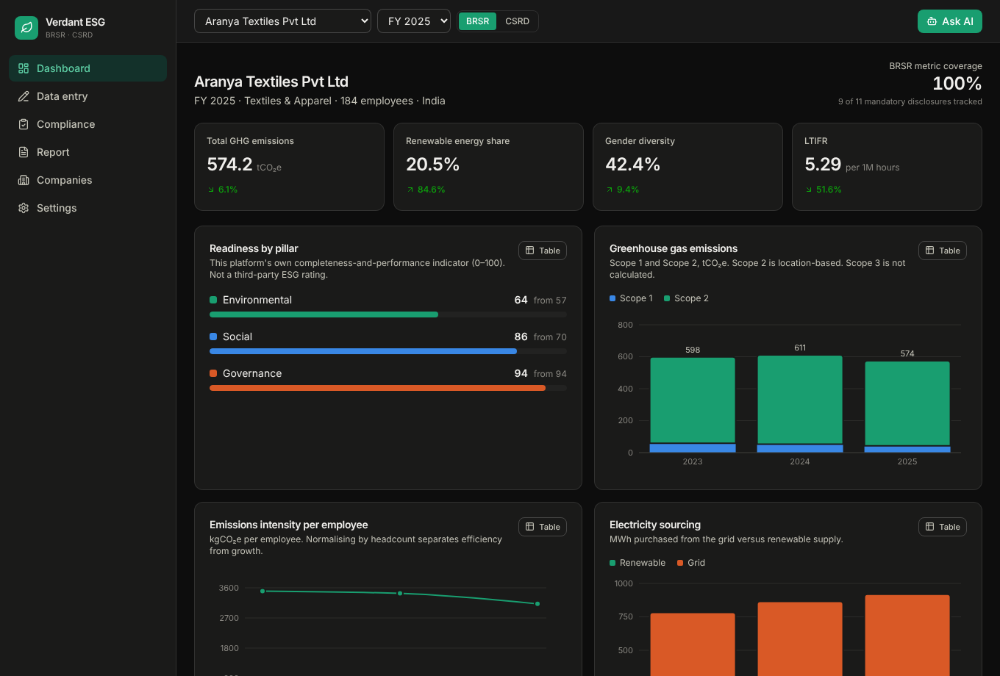

<div align="center">

# Verdant ESG

**ESG reporting automation for small and medium enterprises**

Enter your company data once. Get calculated metrics, a disclosure-by-disclosure
readiness view, an AI-drafted narrative you can edit, and an exportable report.

Aligned to **India's BRSR** (SEBI format) and the **EU's CSRD / ESRS**.

<br>


</div>

<br>



---

## Contents

- [The problem](#the-problem)
- [Features](#features)
- [Screenshots](#screenshots)
- [Quick start](#quick-start)
- [Architecture](#architecture)
- [Project structure](#project-structure)
- [Deployment](#deployment)
- [Backend contract](#backend-contract)
- [Methodology](#methodology)
- [Scope and limitations](#scope-and-limitations)
- [Work split](#work-split)

---

## The problem

Sustainability reporting is now mandatory for a widening set of companies —
SEBI's BRSR in India, the CSRD in the EU. Large firms hire consultants. SMEs
mostly have a spreadsheet, a deadline, and no idea which of several hundred
disclosure points actually apply to them.

This tool closes that gap: structured data entry, automatic calculation with
cited emission factors, an explicit map of what each framework still wants, and
a drafted narrative grounded in the company's own numbers.

---

## Features

| | |
|---|---|
| **Dashboard** | Headline metrics with year-on-year change, emissions and energy trends, and every derived figure shown with the basis it was calculated from |
| **Data entry** | Forms grouped by E / S / G pillar, CSV import with a downloadable template, per-pillar completion tracking |
| **Compliance** | Disclosure-by-disclosure mapping. BRSR Sections A/B/C across the nine NGRBC principles, essential and leadership tiers separated; all twelve ESRS for CSRD |
| **Report builder** | Section-by-section drafting, fully editable before export, with the figures behind each draft listed underneath it |
| **AI assistant** | Answers from the selected company's saved figures. Reports a missing number as missing rather than estimating one |
| **Multi-entity** | Several reporting entities, multiple financial years, year-on-year comparison |

Plus: light and dark themes, keyboard-accessible throughout, a table view behind
every chart, and charts validated for colour-vision deficiency.

---

## Screenshots

<table>
<tr>
<td width="50%"><br><em>BRSR readiness, disclosure by disclosure</em></td>
<td width="50%"><br><em>AI drafts, editable before export</em></td>
</tr>
<tr>
<td width="50%"><br><em>Assistant, grounded in saved figures</em></td>
<td width="50%"><br><em>Data entry by pillar, with CSV import</em></td>
</tr>
</table>

<details>
<summary><strong>Dark theme</strong></summary>
<br>



</details>

---

## Quick start

**Requirements:** Node.js 20 or later.

```bash
git clone https://github.com/Nipun2323/fsd_esg.git
cd fsd_esg/frontend
npm install
npm run dev
```

Open <http://localhost:5173>.

The app ships with demo data for three sample companies, so it runs end to end
before any backend exists. Point it at the API when that is ready:

```bash
cp .env.example .env
```

```ini
VITE_USE_MOCK=false
VITE_API_BASE_URL=http://localhost:8000
```

---

## Architecture

```
┌──────────────────────────────────────────┐
│  React frontend                          │
│  dashboard · data entry · compliance     │
│  report builder · assistant              │
└────────────────┬─────────────────────────┘
                 │  EsgApi  (one typed interface)
        ┌────────┴────────┐
        ▼                 ▼
   mock.ts            http.ts
   demo data          REST  ──────►  FastAPI
                                        │
                      ┌─────────────────┼─────────────────┐
                      ▼                 ▼                 ▼
                 database.py      calculator.py     ai_service.py
                      │                                   │
                      ▼                                   ▼
                    MySQL                           pdf_service.py
```

Every call the frontend makes goes through one interface,
[`frontend/src/api/types.ts`](frontend/src/api/types.ts). Two implementations
satisfy it — bundled demo data and real HTTP — and a single environment
variable selects between them. No screen knows which is in use.

---

## Project structure

```
fsd_esg/
├── frontend/              React + TypeScript web app
│   ├── src/
│   │   ├── api/           client.ts (the switch) · types.ts (the contract)
│   │   │                  mock.ts · http.ts · mockData.ts
│   │   ├── components/    Layout · Assistant · Charts · ui
│   │   ├── data/          frameworks.ts (BRSR + ESRS) · metrics.ts
│   │   ├── lib/           calculator.ts · compliance.ts · store.tsx
│   │   └── pages/         Dashboard · DataEntry · Compliance
│   │                      ReportBuilder · Companies · Settings
│   ├── BACKEND.md         endpoint → Python module mapping
│   └── README.md          full frontend documentation
├── docs/screenshots/
└── (backend)              Python + MySQL — to come
```

`frontend/src/data/` is the part to edit when the regulations change. Framework
definitions and the metric catalogue are data rather than code, and the
compliance screen is generated from them.

---

## Deployment

| Target | Notes |
|---|---|
| **Netlify** | Base directory `frontend`, publish `frontend/dist`. `netlify.toml` included |
| **Vercel** | Root directory `frontend`. `vercel.json` included |
| **Docker** | Multi-stage build behind nginx. `Dockerfile` + `docker-compose.yml` included |
| **GitHub Pages** | `npm run build:pages` (hash routing, since Pages has no SPA fallback) |

`docker-compose.yml` brings up frontend, backend and MySQL together, with a
commented nginx proxy block that serves the API from the same origin and
removes the need for CORS.

> **Note** — variables prefixed `VITE_` are compiled into the JavaScript bundle
> at build time. They are readable by anyone who opens the page, and changing
> one requires a rebuild. The AI API key belongs in the backend's `.env`, never
> here.

---

## Backend contract

[`frontend/BACKEND.md`](frontend/BACKEND.md) maps all ten endpoints to the
Python module that should serve each one, with exact request and response
shapes. The modules stay as the project outline describes them — `database.py`,
`calculator.py`, `ai_service.py`, `pdf_service.py` — with a thin FastAPI layer
calling them.

Two contracts that are easy to get wrong:

**A metric that has not been entered must be `null`, never `0`.** The gap
detection and compliance screens treat an unmeasured figure and a measured zero
as different claims, and so will anyone auditing the report.

**`frontend/src/data/metrics.ts` is the canonical metric catalogue.** The `key`
of each entry is what both API payloads and the MySQL `esg_data.metric_name`
column should use.

---

## Methodology

**Emission factors** carry their source and vintage, and are overridable in the
app's Settings so results stay reproducible.

The grid factor defaults to **0.727 kg CO₂e/kWh** — the CEA weighted average for
FY 2023-24. The widely-quoted 0.82 is the FY 2015-16 figure; India's grid has
decarbonised since, and using it would overstate emissions by roughly 13%.

**Calculations** live in
[`frontend/src/lib/calculator.ts`](frontend/src/lib/calculator.ts), written
dependency-free so they port to `calculator.py` directly. Scope 2 is
`kWh × grid factor ÷ 1000` → tCO₂e, location-based. LTIFR is injuries per one
million hours worked.

**Readiness percentages** count only disclosures backed by a numeric metric.
Disclosures requiring narrative are reported separately rather than dropped from
the denominator, so the headline figure cannot overstate how finished a report
is.

---

## Scope and limitations

Stated plainly, because an ESG tool that overstates its coverage is worse than
no tool at all.

- **Scope 3 is not calculated.** For many SMEs, value-chain emissions are the
  majority of the footprint.
- **Scope 2 is location-based only.** A market-based figure requires contractual
  instrument data this tool does not collect.
- **Readiness covers numeric metrics only.** Both BRSR and the ESRS also require
  narrative, policy and process disclosures.
- **No double-materiality assessment.** That assessment is what determines
  whether an ESRS topical standard applies at all, so every topical standard is
  shown as conditional.
- **This is not assurance.** Figures need review by a competent person before
  any filing.

Framework details were checked against public sources. Scope thresholds and
assurance timelines under both regimes have been amended more than once —
verify against the live SEBI circular or current ESRS text before relying on a
date.

---

## Work split

| Area | Files |
|---|---|
| Frontend | `frontend/src/pages`, `frontend/src/components` |
| Database | `database.py`, MySQL schema |
| Calculations & PDF | `calculator.py`, `pdf_service.py` |
| AI integration | `ai_service.py`, prompts |

Each module has one job, so the work parallelises without collisions.
